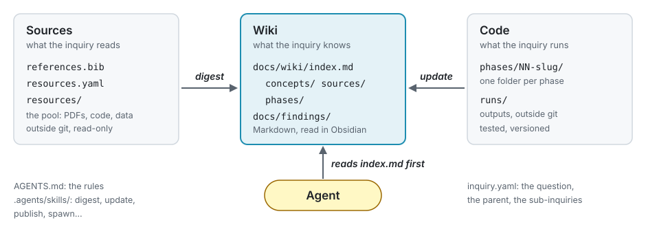

# research-knowledge-tree

**Agents make rigour affordable.** Pre-registered protocols, verification on known cases, numbers that trace to their run, published negative results, adversarial review: research has long known what keeps it honest, and has rarely been able to pay for all of it. An AI agent can. This repository is a handful of rules that make an agent do research that way, and a small tool that checks them.

The unit is an **inquiry**: one folder, one git repository, one research question. Start with one. When a question proves too broad, an inquiry grows **sub-inquiries** for its parts (zoom in); when two inquiries turn out to answer parts of a bigger question, a new one **adopts** them (zoom out). The result is a **knowledge tree**: the broad question at the root, the narrow checks at the leaves, and knowledge flowing between them by explicit rules.

The ideas behind it are in the talk *Doing research with AI agents*: [slides (PDF)](talk/doing-research-with-ai-agents.pdf).

## Inside an inquiry: sources, wiki, code



Everything the agent knows is plain Markdown in the folder, read by you in [Obsidian](https://obsidian.md) and by the agent before it answers. Sources are digested into the wiki, one note per source stating what the inquiry takes from it; code changes update the wiki in the same turn; what a phase establishes becomes a **finding**, with its status and its evidence. You can switch model or harness and keep all of it.

<details>
<summary>Every file of an inquiry</summary>

```
inquiry.yaml      the question, the parent, the sub-inquiries, the Zotero collection, the rule packs
AGENTS.md         the agent's instructions: the tree, the twelve rules, a phase, the wiki
CLAUDE.md         imports AGENTS.md, for Claude Code
PLAN.md           the question, the rules as adjusted (and why), the protocol, the phases, the deviations
GLOSSARY.md       this inquiry's terms
references.bib    the documents, never written by hand     } the resource manifest:
resources.yaml    code at a pinned commit, data and sha256 } rkt fetch fills resources/
docs/
  wiki/           index.md (with the routes to the sub-inquiries), concepts/, sources/, phases/
  findings/       one note per finding, and the finding format
  adr/            decisions
rules/            rule packs: rigour, fe-simulation, ml-training, uq-reliability, literature-check
phases/NN-slug/   one folder per phase: its code and config.yaml (explore or confirm, its level)
inquiries/        sub-inquiries, each its own clone (out of git)
resources/        the link to the pool (out of git)
.agents/skills/   the kit's skills; .claude/skills links here
.claude/settings.json   declares Matt Pocock's skills for Claude Code
```

</details>

## Between inquiries: the tree

```
bicycle/                       why does a moving bicycle stay upright?
├── inquiry.yaml               lists its sub-inquiries
├── docs/wiki/index.md         routes: which child to dive into for what; open questions; out of scope
└── inquiries/
    ├── benchmark-model/       does our model reproduce the published benchmark bicycle?
    │   └── inquiries/
    │       └── speed-sweep/   at which speeds is the benchmark bicycle self-stable?
    ├── gyroscopic/            how much does the spinning of the wheels contribute?
    └── trail/                 how much does the steering geometry contribute?
```

- **Down**, a child receives its question and its parent's rules. It may tighten them, never loosen them, and reads its parent's notes by link, never by copy.
- **Up**, a child gives findings only, one level at a time: the parent writes its own finding in its own terms, citing the child's at a commit. Detail stays at the level it belongs to.
- **Across**, nothing: links go to the parent or a child, never to a sibling. A source two branches need is digested at their lowest common ancestor.
- **Routing**: every index lists its children with what to dive into each for, the questions still open (*"how much does the rider's steering contribute?"*), and what is out of scope and why. Asked a broad question, the agent descends one index at a time.

## Start in five minutes

1. Install [uv](https://docs.astral.sh/uv/), then the tool:

   ```bash
   uv tool install git+https://github.com/bonneted/research-knowledge-tree@v2.0.0
   ```

2. Make a folder an inquiry, and a git repository:

   ```bash
   mkdir bicycle && cd bicycle && git init
   rkt init
   ```

3. Open it with your agent and say: *start the inquiry: why does a moving bicycle stay upright?* It interviews you on the question, its scope and what you already know, shows you the rules on one screen and asks whether to keep them, then digests your sources and proposes a first phase.
4. Open the folder in Obsidian to read the wiki as it grows.

Day to day, the prompts are short: *"add 10.1126/science.1201959 and digest it"*, *"plan phase 1: reproduce the benchmark's stability speeds"*, *"what does the wiki say about trail?"*, *"publish the findings of phase 1"*, *"spawn a sub-inquiry for the gyroscopic effect"*. Type `/ask-tree` when you do not know what comes next.

## The rules

Twelve core rules, in every inquiry's `AGENTS.md`. **Fixed** ones are never set aside; **adjustable** ones may be, for one inquiry and its sub-inquiries, with the reason written in `PLAN.md`. When you ask for something that would break a rule, the agent names the rule and the bias it guards against, says whether that bias matters here, and offers a way within the rule; then you decide.

| | Rule | Guards against | |
|---|---|---|---|
| **Planning** | 1. Explore or confirm: a confirm phase fixes its protocol (analysis, stopping rule, the result that would refute the claim) before its first run | testing hypotheses the data suggested | adjustable |
| | 2. Grounded knowledge per token: each phase declares how much it spends to ground its answer (`scout`, `build`, `publish`) | rigour where it is not needed, claims stronger than what was spent | adjustable |
| **Evidence** | 3. Verification on a case with a known answer before a new result | method bugs read as findings | adjustable |
| | 4. Every number traces to a run, a derivation or a page, with its unit | untraceable numbers | fixed |
| | 5. No selection on the reported metric | tuning on the test set, leakage | adjustable |
| | 6. Uncertainty with every headline number: an estimate with its interval | false precision | adjustable |
| | 7. A competent baseline, tuned with the same budget | straw men | adjustable |
| **Claims** | 8. Source claims cite their page and were checked; inferences are marked; references enter by identifier | hallucinated and laundered citations | fixed |
| | 9. A claim states its scope; a claim about the world needs validation, not only verification | over-generalisation | adjustable |
| | 10. Negative results and the denominator (how many attempts) are published | the file drawer, forking paths | fixed |
| **The tree** | 11. The tree never strengthens a claim: a synthesis is no stronger than its weakest sub-inquiry evidence | status inflation on the way up | fixed |
| | 12. The human confirms: you approve a confirm protocol, and each finding promoted to `confirmed`, after a blind review | the agent certifying its own work | fixed |

Rule packs add rules for a kind of work. `rigour` turns rules 1 and 4 into mechanism: a stamp on every run, a frozen protocol, pinned conda environments, canary reruns.

What the rules produce is a finding like this one, at the root of the tree above (illustrative):

```markdown
---
status: hint        # its children's findings are hints: rule 11
tried: 3            # explanations tested: wheel spin, trail, mass distribution (rule 10)
evidence:
  - kind: sub-inquiry
    finding: https://github.com/you/gyroscopic/blob/8be41d0/docs/findings/the-model-stays-self-stable-without-wheel-spin.md
    status: hint
  - kind: sub-inquiry
    finding: https://github.com/you/trail/blob/3f2a9c1/docs/findings/the-model-stays-self-stable-without-trail.md
    status: hint
---

# Neither wheel spin nor trail alone keeps the benchmark bicycle upright

**Scope.** The linearised benchmark model only; not yet validated against a ridden bicycle (rule 9).
```

### Why these rules

They are the standard countermeasures of the reproducibility literature, chosen for the biases an agent amplifies: an agent makes forty variants nearly free (rule 10), writes fluent citations it never read (rule 8), and agrees with whoever asks (rule 12). The frame is Ioannidis (2005), [*Why most published research findings are false*](https://doi.org/10.1371/journal.pmed.0020124), and Munafò et al. (2017), [*A manifesto for reproducible science*](https://doi.org/10.1038/s41562-016-0021); behind each rule are, among others, preregistration and HARKing (Nosek et al. 2018; Kerr 1998), verification and validation (Oberkampf & Roy 2010), leakage (Kapoor & Narayanan 2023), weak baselines (Lin 2019) and the file drawer (Rosenthal 1979). [docs/literature.md](docs/literature.md) maps every rule to its references, all checked against Crossref or arXiv. Rules 2 and 11 have no standard precedent: they are this template's own, and deserve the same scrutiny.

## Growing the tree

- **Zoom in**: *"spawn a sub-inquiry for the gyroscopic effect"* (`spawn`). The child is a clone in `inquiries/<name>/`, made from the kit, with its question, its parent and its Zotero subcollection; the parent's index gets its route.
- **Zoom out**: `/adopt` in a parent puts an existing repository under it. To merge two repositories, `rkt init` a new root whose question both answer part of, then adopt each. A repository made without the kit is adopted too: the kit fills what is missing and keeps its files.
- **Prune**: `/detach` lets a child stand alone again.

`rkt check --tree` verifies what a machine can tell of the rules: links resolve and never go sideways, every note is reachable, routes match the sub-inquiries, findings carry their denominator and no parent finding is stronger than its children's. Whether a baseline was competent is the reviewer's to judge, and yours.

## Sources and Zotero

`references.bib` and a pool of files are the contract; Zotero is the recommended way to keep them, not a requirement. The pool is one folder per machine, shared by every tree, outside git: `~/research-pool` unless the configuration's `pool` or `RKT_POOL` says otherwise. Each inquiry's `resources/` links to it, with `papers/<citekey>.pdf`, `code/<name>/` and `data/<name>`.

**Without Zotero (two minutes).** Leave `zotero_collection` out of `inquiry.yaml`. `rkt refs add <DOI | arXiv id | URL>` writes the entry into `references.bib` from Crossref, DataCite or arXiv; `rkt fetch` takes the PDF from arXiv or Unpaywall (give an `email` in the configuration) or lists what to drop into the pool. A `.bib` exported from any reference manager works too.

**With Zotero (ten minutes).** Collections mirror the tree: `bicycle`, `bicycle/gyroscopic`, …

1. In Zotero, [create an API key](https://www.zotero.org/settings/keys) with write access, and note your library (`users/<id>`, or `groups/<id>`).
2. Install [Better BibTeX](https://retorque.re/zotero-better-bibtex/) for citekeys, and [ZotMoov](https://github.com/wileyyugioh/zotmoov) to keep attachments in one folder of your own (a synced drive works). Set Zotero's *Linked Attachment Base Directory* (Settings, Advanced, Files and Folders) to that folder, so the paths Zotero records are portable.
3. Write `~/.config/rkt/config.yaml`:

   ```yaml
   zotero:
     library: users/1234567
     api_key: <the key>
   zotero_base: ~/OneDrive/ZotMoov   # the ZotMoov folder, or its synced copy
   zotero_local: true                # only where the Zotero app runs: ask it directly
   email: you@example.org            # for Unpaywall
   ```

4. Set `zotero_collection` in `inquiry.yaml` (`bicycle/gyroscopic`). Then `rkt refs add <id>` files the item in that collection and regenerates `references.bib`, `rkt refs pull` does it after you edit in Zotero, and `rkt fetch --tree` pulls every bibliography of the tree and copies each PDF into the pool under its citekey.

A machine without the Zotero app (a workstation) needs only the API key and the synced ZotMoov folder: the Web API gives each attachment's record, and `rkt` reads the file from the folder. Under WSL, the Zotero app on Windows answers `zotero_local` only with WSL's mirrored networking.

## Commands

| | |
|---|---|
| `rkt init [folder] [--question …]` | make a folder an inquiry from the kit, keeping files already there |
| `rkt refs add <id>`, `rkt refs pull` | the bibliography, by identifier: never BibTeX by hand |
| `rkt fetch [--tree]` | the pool, filled from every manifest; what is missing, with the command that copies it in |
| `rkt check [--tree]` | links, indexes, routes, findings, citations, phases: one line per problem |
| `rkt freeze phases/NN-slug` | the rigour pack's protocol freeze |

## Harnesses

- **Claude Code** reads `CLAUDE.md` (which imports `AGENTS.md`) and the skills through `.claude/skills`. The inquiry's `.claude/settings.json` declares [Matt Pocock's skills](https://github.com/mattpocock/skills) (`grilling`, `domain-modeling`, `tdd`, …), which the kit's skills lean on: Claude Code offers them once you trust the folder.
- **Other harnesses** (Codex, Gemini CLI, OpenCode, …) read `AGENTS.md`; point them at `.agents/skills/`, and install Matt Pocock's skills as their README says.
- **Windows** without admin rights: `rkt` makes folder links as junctions.
- **Confidential material** stays out of the inquiry's folder. If it sits elsewhere on the same machine, keep the agent from it with your harness's permission settings (in Claude Code, `permissions.deny` in your user or local settings).

## Limits

Agents can invent citations and numbers: the rules and `rkt check` make that harder, not impossible, so check what matters against the source. Whatever you give the agent goes to the model provider: check your institution's and your partners' rules before sharing unpublished data or papers under review.

## Working on the template

`kit/` is what an inquiry contains; `tools/rkt/` is the tool; `docs/adr/` records the design. `uv run python -m pytest` and `uvx ruff check` before a commit. See `AGENTS.md`.

## License

[MIT](LICENSE).
